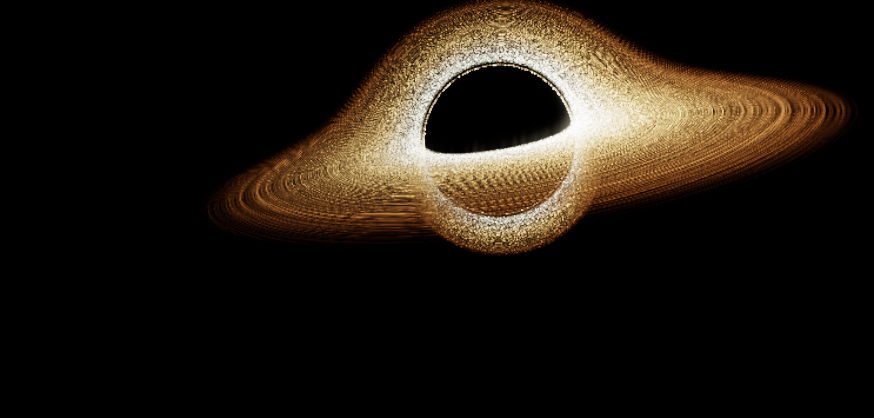
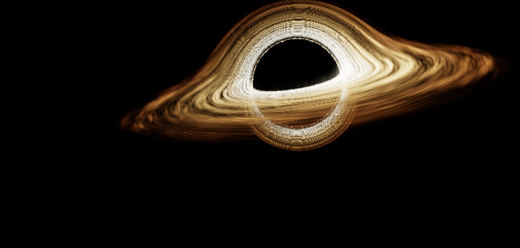
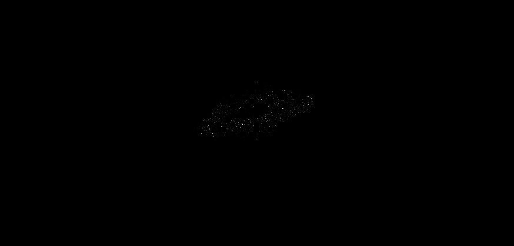
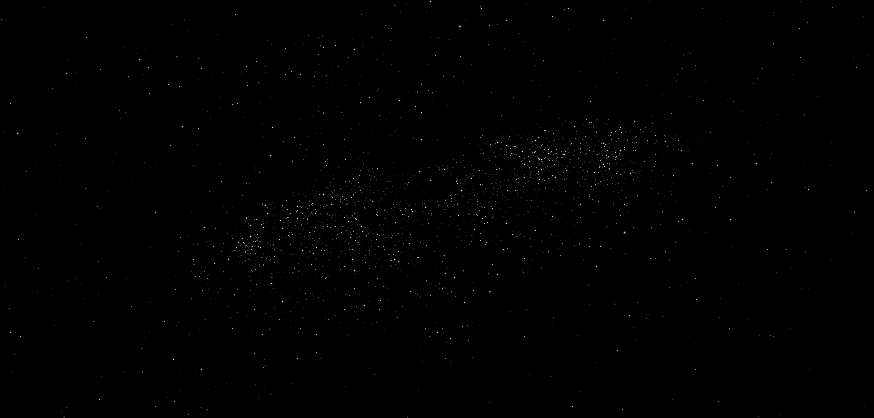

# Stardust and accretion-flow reliability

Scope: the approved HackStellar scene and its rendering lifecycle. The organizer identified the **third supplied screenshot** as the correct appearance. No website content, HTML, CSS, camera path, particle count, particle velocity, palette, lighting coefficients, lensing geometry or quality thresholds are changed.

## Reproduced defects

### 1. Differential advection winds away coherent flow

The previous material used `angle - time * orbitalSpeed(radius)` for the entire visit. Because orbital speed varies with radius, the radial derivative of this coordinate grows without bound. Recognizable luminous lanes become increasingly fine bands and then noisy, spatially incoherent detail. Recession and lower render resolution make this more apparent. This happens while idle as well as during scrolling; scrolling is not its root cause.

The earlier explicit texture-level correction prevented automatic mipmaps from averaging the material away. It did **not** bound the material's underlying shear. Raw frame differences could consequently count changing pixel noise as successful flow. This follow-up compares spatially coherent motion as well as raw pixels, and visually reviews the actual rendered images. The baseline disk-only captures reproduce the finely wound appearance in the reported broken states; the corrected output retains the broader flowing structures of the approved reference.

`createPipeline().render()` now supplies two bounded advection phases. Each field keeps the original radius-dependent angular speed. Their angular anchors retain long-term rotation, while an eight-second renewal interval bounds radial winding. A two-second smoothstep overlap renews a field only at zero weight, with continuous value and first derivative. **The scene clock is never wrapped or restarted.** Camera, particles and sky keep their existing time source. `matter()` and `advectedPattern()` share geometry, thermal color and Doppler calculations; only the pattern signals need overlapping evaluation. Outside the overlap, one pattern is evaluated.

The original appearance is retained through the first fourteen seconds, within floating-point rounding. Later material evolution necessarily differs from the faulty indefinitely wound field. This is restoration of coherent motion, not a claim that every later frame is pixel-identical. The silhouette, physical camera transforms, brightness/color equations, local orbital rates and texture asset remain the same.

### 2. Empty space incorrectly occludes dust in the byte-buffer fallback

When floating-point color attachments are unavailable, the existing pipeline uses an unsigned-byte render target. Its background depth code `.5` rounds to `128/255`, or approximately `.50196`. The old test `packed > .5001` then marks **empty space as shadow**, decoding it as a very near occluder. Active dust behind that false surface disappears.

The particle shader now receives a format-aware shadow threshold: the original `.5001` for HDR, and the midpoint between byte codes 128 and 129 for the fallback. This changes no particle geometry, size, velocity, distribution, colors or alpha profile. HDR particle compositing is pixel-identical in the isolated A/B cases. The fallback test forces the existing byte-target path on the test GPU; it does not pretend this machine lacks HDR support.

### 3. Context restoration deletes handles from an obsolete context

The old restore handler disposed the old pipeline **after** Three.js rebuilt its GL state. Repeated loss/restoration produced `INVALID_OPERATION: object does not belong to this context` for textures, programs and vertex arrays, even without GPU instrumentation.

Old pipeline resources are now disposed during the context-loss handler. The restore handler builds fresh resources without deleting stale handles against the new context. The accumulated scene time and current scroll state remain intact. Resize tolerates the interval when no pipeline exists. A page disposed during loss cannot be revived by a later restore event.

The GL errors are independently reproduced lifecycle defects. The tests do not establish that these errors caused every reported visual occurrence.

## Production files/functions

- `visuals/shaders.js`: `advectedPattern()` and `matter()` bound coherent material advection while sharing the original shading terms.
- `visuals/pipeline.js`: `createPipeline()` supplies framebuffer-aware shadow classification; `render()` calculates bounded pattern phases once per frame.
- `visuals/particles.js`: `createDust()` fragment shader uses that threshold.
- `visuals/experience.js`: `startExperience()` context-loss/restoration, resize and page-disposal handlers release resources in the correct order.

The explicit `textureLod` sampling correction remains. The animation clock, scroll smoothing, camera choreography, adaptive resolution limits, postprocessing, environmental shells and website sections are preserved. The renderer checksum fixture updates only these four files for this authorized bug fix.

## Reproducible verification

Run the local server, then use the Python environment containing Playwright and Pillow:

```sh
python tests/lifecycle_layers_check.py http://127.0.0.1:8000
python tests/lifecycle_fallback_check.py http://127.0.0.1:8000
python tests/lifecycle_context_check.py http://127.0.0.1:8000
python tests/lifecycle_navigation_check.py http://127.0.0.1:8000 --no-video
python tests/lifecycle_runtime_check.py http://127.0.0.1:8000
python tests/ring_freeze_check.py http://127.0.0.1:8000
python -m unittest discover -s tests -p 'test_*.py'
```

Omit `--no-video` to record the full navigation sequence. The diagnostic fixtures use the actual pipeline; their layer isolation, forced framebuffer fallback and accelerated ages are never enabled on the public website. Baseline fixtures retain the pre-fix source from commit `33cea90`. The historical mipmap regression fixture also uses that unbounded baseline when selecting its legacy lookup, so it remains an independent reproduction of the earlier defect.

`tests/lifecycle-audit/` contains machine-readable results, independently isolated frame pairs and visual evidence. Disk cases fix the camera and remove sky/particles from the diagnostic render. Orbital/world dust cases use the actual ray-depth target. Composited page observations supplement those layer checks; camera movement alone is not accepted as proof of disk motion.

## Coverage and limits

The checks cover initial loads, hands-off idle, full-range slow/fast/irregular scrolling, nine camera-path stops, repeated top/bottom returns, home/directory navigation, actual back-forward-cache restoration, resizing and mobile orientation changes, reduced-motion pause/resume, visibility-handler suspension and repeated context recovery. GPU uploads/readback verify shared disk/dust time; layer-specific frame pairs verify visible movement independently.

Accelerated ages up to 7,200 seconds test material stability, not a real two-hour endurance session. Native testing uses Chromium with ANGLE/Metal on Apple M4. Mobile tests emulate viewport/touch and the existing constrained rendering preset; they are not physical-phone or Safari certification. Headless minimization did not generate a native hidden-tab transition, so the visibility handler is explicitly emulated and labeled as such.

Ordinary navigation did not reproduce a stopped disk clock or unexpected culling. These fixes address the independently reproduced shear, fallback occlusion and context-resource defects; they do not establish that every possible browser/GPU incident has the same cause. The user's browser/device was not supplied.

## Completed verification on the saved implementation

- **144 disk cases**: nine camera-path positions, four simulated ages (0, 30, 300 and 7,200 seconds), two volume resolutions and desktop/mobile presets. Fixed-camera, sky-free, particle-free frame pairs retain coherent disk movement.
- **36 isolated dust cases**: orbital and world-space groups separately remain visible and move across all nine poses on both presets.
- **24 initial-appearance comparisons**: the first fourteen seconds match the original rendered scene within a mean channel difference of 0.01/255; twelve continuity checks, including renewal boundaries, show smooth handoffs.
- **18 framebuffer comparisons**: HDR dust output is pixel-identical; the byte-buffer correction restores dust at all poses. At the receded pose, bright dust pixels increase from **522 to 3,495**, with the same particle count and geometry.
- **Six context cycles**: three historical cycles reproduce GL error 1282; three corrected cycles produce error 0, including resize during loss and restoration under reduced motion.
- **52 real-page observations**: three fresh loads and five full scroll cycles on each of desktop/mobile, plus resizing/orientation, home/directory navigation, actual back/forward-cache restoration, context restoration and pause/resume. No duplicate animation callbacks, GL errors or JavaScript errors were recorded. Each stationary observation includes actual composited frame changes as well as synchronized GPU-time checks.
- **Prior regression rerun**: thirty historical/current sampling cases and another 26 live GPU checkpoints pass. Its current results and unaccelerated recording are in `tests/lifecycle-audit/prior-regression/`; the original `tests/ring-audit/` captures retain the historical report's evidence.
- **Six unit/build checks** pass, including content integrity and the renderer checksum guard. Other website source files remain byte-for-byte unchanged.

The final no-recording runtime profile measured approximately **53.7 FPS at 1440 × 900** and **49.6 FPS at 1920 × 1080 / DPR 1.25**, using the existing adaptive resolution policy. The actual scene clock advanced at wall-clock speed. These are local measurements, not a promise of 60 FPS on every device. A contemporaneous pre-fix-shader run is retained separately; machine load varies, so it is not evidence of a universal performance improvement.

## Actual rendered evidence

The following disk-only views use the same fixed camera and simulated age of 300 seconds. They exclude sky and separate particles solely to make material behavior inspectable.

| Before: wound, noisy material | After: coherent luminous lanes |
|---|---|
|  |  |

The [corrected frame two seconds later](tests/lifecycle-audit/desktop-disk-after-2s.png) shows the lanes flowing with the camera fixed. These are screenshots of the real renderer, not generated illustrations.

| Byte-buffer fallback before | Same dust system after |
|---|---|
|  |  |

The [unaccelerated page recording](tests/lifecycle-audit/prior-regression/repeated-load-scroll-navigation.webm), [desktop resting frame pair](tests/lifecycle-audit/desktop-rest-0.5-a.png) / [second frame](tests/lifecycle-audit/desktop-rest-0.5-b.png), and [mobile recovery frame pair](tests/lifecycle-audit/mobile-context-restored-a.png) / [second frame](tests/lifecycle-audit/mobile-context-restored-b.png) supplement the isolated layer evidence. Full measurements are in the JSON files alongside these images.
